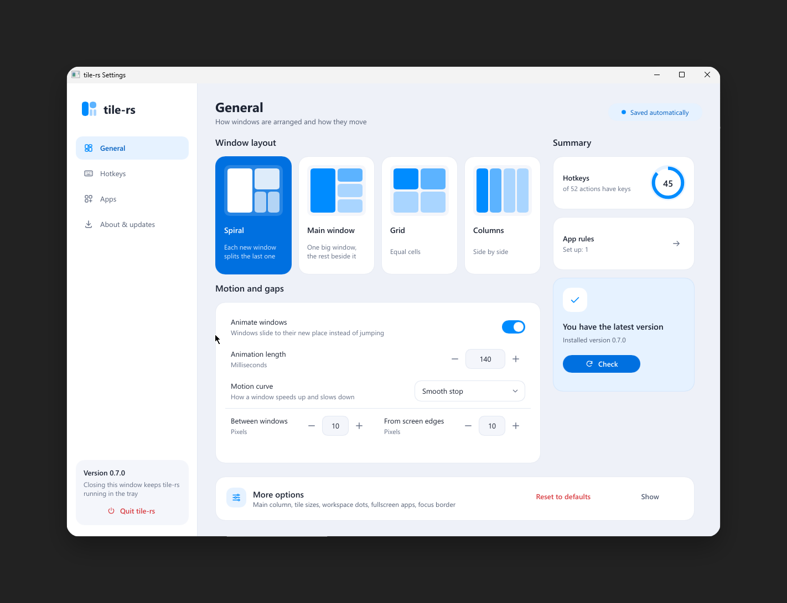
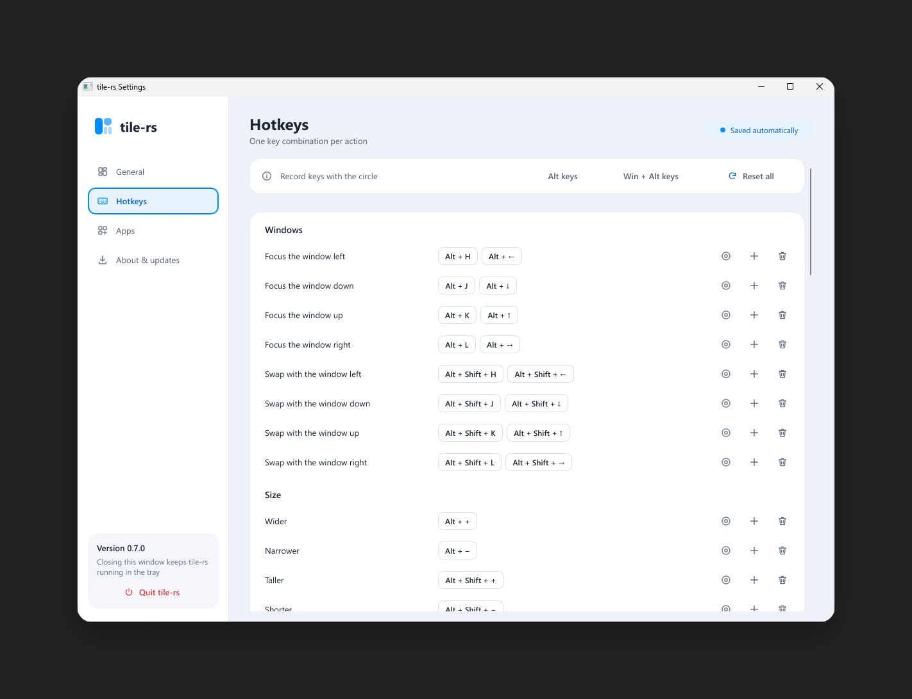

# tile-rs

A small **spiral tiling window manager for Windows 10/11**, written in Rust. Open windows are
arranged automatically in a spiral, you move and resize them with the keyboard or the mouse, and
everything lives in one small `.exe` with a tray icon and a plain-text config.

[Русская версия](README.ru.md) · [Configuration reference](docs/CONFIGURATION.md) ·
[Development & testing](docs/DEVELOPMENT.md) · [Changelog](CHANGELOG.md) ·
[Releasing & versioning](docs/RELEASING.md)



## Features

- **Settings launcher**: a window in its own process (tray menu -> *Settings...*, or on first start)
  for everything you would otherwise edit in `config.toml`: layout, gaps, animations, the focus
  border, workspaces, **hotkeys** (record a combination by pressing it) and **application rules**
  (pick a running program, choose "floating window" or "workspace N"), plus update checking and
  installing.
- **Monocle** (`Alt+M`): show the focused window alone on the whole screen and flip through the
  other windows of the workspace with the focus keys; press again to get the layout back.
- **Four layouts** (settings launcher, tray or the `layout` setting): **spiral** (dwindle, the
  default - window 1 takes the left part, window 2 the top-right, and so on), **master-stack** (a
  master column on the left, the rest stacked on the right; `Alt+.` / `Alt+,` put more or fewer
  windows into the master column), **grid** and **columns**. Close or open a window and the rest adapt.
- **Jump back**: `Alt+Z` returns to the previously focused window, `Alt+Shift+Z` to the previous
  workspace.
- **New windows appear in their tile immediately** (no flash in the middle of the screen); the other
  windows glide aside with a short animation.
- **Resize like a normal window**: drag any edge or corner and the neighbours follow live. Or use
  `Alt +` / `Alt -` (hold to repeat).
- **Live tile resize**: applications reflow their own content while affected windows resize together,
  without screenshot overlays. Input is coalesced per frame and slow clients are paced independently;
  [details and limitations](docs/WINDOW-MOTION.md).
- **Draggable tile gaps** in Spiral and Master/stack: hover inside a gap and drag to resize the actual
  windows. Press Escape to restore the original layout.
- **Drag a window onto another tile** to swap them; drop it anywhere else and it snaps back.
- **Fullscreen games and videos**: a window that covers a whole screen without a title bar
  (exclusive or borderless fullscreen) is never tiled. It is minimized when you switch to another
  workspace and restored when you switch back, so it stays fullscreen but does not block your other
  workspaces.
- **Multiple monitors**: every screen keeps its own layout and current workspace, and a window
  tiles on the screen it is on (move it to another screen and it re-homes there).
- **9 workspaces per monitor**, per-app rules (always float, open on workspace N), focus and swap by
  keyboard.
- **Tray icon** with pause/resume, reload config, edit config, "Start with Windows", quit.
- **Coloured border** around the focused window, drawn by tile-rs itself so it shows for every
  window (including consoles like Windows PowerShell).
- **Adapts to your screen**: tiles never get narrower than `min_tile_width`/`min_tile_height` (the
  master tile narrows to make room), and once a workspace is full a new window opens on the next
  workspace. Minimal clickable dots at the top of each monitor show current and occupied
  workspaces: the active dot is blue with an outline, occupied dots glow blue, and empty dots are dim.
- Everything is also in a plain `config.toml` (hotkeys, gaps, animation, rules) for those who prefer text.

## Requirements

- Windows 10 or 11, 64-bit.
- Nothing else to install. It does not need administrator rights.

## Install

### Option 1: installer (recommended)

1. Open the [latest release](../../releases/latest) and download `tile-rs-X.Y.Z-setup.exe`.
2. Run it and follow the wizard (no administrator rights needed). You can tick *Start tile-rs when
   I sign in* and *Create a desktop shortcut*.
3. At the end, tick *Start tile-rs now* (or double-click the shortcut). The **settings launcher**
   opens and tile-rs starts in the system tray.
   - The installer is **not code-signed**, so Windows SmartScreen may warn you the first time:
     click *More info* → *Run anyway*.

### Option 2: portable zip

1. Open the [latest release](../../releases/latest) and download `tile-rs-vX.Y.Z-windows-x64.zip`.
2. *(Optional, recommended)* Check the download against the `.sha256` file from the same release:
   ```powershell
   Get-FileHash .\tile-rs-vX.Y.Z-windows-x64.zip -Algorithm SHA256
   ```
3. Unzip it to any folder you keep (for example `C:\Tools\tile-rs`). Do not run it from inside the zip.
4. Double-click `tile-rs.exe`. The settings launcher opens and tile-rs starts in the system tray.

### Option 3: build from source

Prerequisites: [Rust](https://rustup.rs) (stable) and the *Desktop development with C++* workload
of the [Visual Studio Build Tools](https://visualstudio.microsoft.com/visual-cpp-build-tools/).

```powershell
git clone https://github.com/ponslookspain/tile-rs.git
cd tile-rs
cargo build --release
# the program is target\release\tile-rs.exe
```

### Update

Quit tile-rs (tray icon → *Quit tile-rs*), replace `tile-rs.exe` with the new one, start it again.
Your config is kept; settings introduced by the new version are appended to it automatically (a copy
of the old file is saved as `config.toml.bak`).

### Uninstall

1. Tray icon → untick *Start with Windows*, then *Quit tile-rs*.
2. Delete the folder with `tile-rs.exe`.
3. Optional clean-up: delete `%APPDATA%\tile-rs` (config) and `%LOCALAPPDATA%\tile-rs` (log).
   If autostart was still on, remove its entry:
   ```powershell
   Remove-ItemProperty HKCU:\Software\Microsoft\Windows\CurrentVersion\Run -Name tile-rs
   ```

## Using it

### Settings launcher

Click the tray icon (or right-click it and choose **Settings**). On first start the settings open
with a short tour: it asks you to try three things (move between windows, swap two windows, send a
window to another workspace) and ticks each one off as you do it. If tiling is not for you, the tour
can pause it. Pages:

| Page | What you change there |
|---|---|
| General | the layout (with a live preview), animation and gaps, a summary; **More options** holds the main column, tile sizes, workspace dots, fullscreen apps, the focus border and **Reset to defaults** |
| Hotkeys | every action: record a new combination, add a second one, remove it, reset all; switch every key between Alt and Win + Alt in one click |
| Apps | rules per program: always floating or always on workspace N; pick an open window or any `.exe` |
| About & updates | start with Windows, open the config or the log, check for and install updates |

Changes apply by themselves a moment after you make them; the header says *Saving…* until they
are saved. Combinations that Windows refuses (because another app uses them) are marked in the
hotkey list. While tiling is paused the header says so and offers **Resume**.



### Default hotkeys

| Keys | Action |
|---|---|
| `Alt+H/J/K/L` or `Alt+←↓↑→` | focus the window left / below / above / right |
| `Alt+Shift+H/J/K/L` or `Alt+Shift+←↓↑→` | swap the focused window with that neighbour |
| `Alt+1` … `Alt+9` | switch to workspace 1…9 |
| `Alt+Shift+1` … `Alt+Shift+9` | move the focused window to workspace 1…9 and follow it there |
| `Alt+Shift+.` / `Alt+Shift+,` | go to the next / previous workspace (wraps around) |
| `Ctrl+Alt+.` / `Ctrl+Alt+,` | move the focused window to the next / previous workspace and follow it |
| `Alt+=` / `Alt+-` (also `Alt+Num+` / `Alt+Num-`) | make the focused window wider / narrower (hold to repeat) |
| `Alt+Shift+M` | minimize the focused window |
| `Alt+Shift+F` | float the focused window in place, or tile it again |
| `Alt+M` | monocle: the focused window on the whole screen, and back |
| `Alt+Z` | focus the previously focused window |
| `Alt+Shift+Z` | go back to the previous workspace |
| `Alt+.` / `Alt+,` | master-stack: one more / one fewer window in the master column |
| `Alt+Shift+Q` | close the focused window (like Alt+F4) |
| `Ctrl+Alt+L` | switch to the next layout (spiral, master-stack, grid, columns) |
| `Ctrl+Alt+P` or `Alt+Shift+P` | pause / resume tiling |
| `Ctrl+Alt+Q` | quit (all windows are brought back to the current workspace) |

Optional actions without a default key: `grow_height`, `shrink_height`, `retile`, `reload_config`,
`edit_config`, `focus_next_monitor`, `move_to_next_monitor` and their `prev` versions. Every hotkey can
be changed or removed on the launcher's **Hotkeys** page or in [the configuration reference](docs/CONFIGURATION.md).

### Mouse

- Drag an **edge or corner** of a tiled window to resize it; the other windows adapt live.
- Drag a window **onto another tile** to swap the two. Dropped anywhere else, it returns to its tile.
- Drag a window **onto a workspace dot** at the top of a screen to send it to that workspace (the dot
  lights up while you hover it). You stay where you are.
- **Click a workspace dot** to switch to that workspace; **right-click** it to open it or move the
  active window there.
- Maximized windows and dialogs are left alone.

### Tray menu (right-click the icon)

*Settings*, *Pause / Resume tiling*, *Arrange windows again* (also resets all sizes to equal
halves), *Show hotkeys*, *More* (*Check for updates*, *Edit config file*, *Reload config file*,
*Open config folder*, *Open log*, *Export window diagnostics*), *Start with Windows*, *Quit tile-rs*.
A left click on the icon opens the settings. Pausing shows a notification; while paused, every
hotkey except pause/quit/reload/edit is handed back to your applications.

### Command line

```
tile-rs.exe              start and open the settings launcher
tile-rs.exe --autostart  start silently (what the autostart entry uses)
tile-rs.exe list         show which windows would be tiled, and why others are not
tile-rs.exe diagnose     export window diagnostics from the running manager
tile-rs.exe tile         arrange the current windows once and exit
tile-rs.exe --restore-windows  bring back windows left off-screen after a crash or a kill
tile-rs.exe --version
```

The tray's **Export window diagnostics** saves a JSON snapshot beside the log without window
titles. `diagnose --titles` includes titles explicitly. For a separate read-only native snapshot,
use `diagnose --output C:\path\windows.json`; see [diagnostic details](docs/CONFIGURATION.md#window-diagnostics).

## Configuration

The file is `%APPDATA%\tile-rs\config.toml`. Open it from the tray (*Edit config*), save, then
choose *Reload config*. A mistake never breaks the running program: you get a message with the
line, and the previous settings stay active. To get the defaults back, delete the file and start
tile-rs again.

```toml
inner_gap = 10           # pixels between windows
outer_gap = 10           # pixels around the screen edges
animations = true
animation_ms = 140
easing = "out_cubic"     # animation curve: linear, out_quad, out_cubic, out_quart, in_out_cubic
fullscreen_windows = "minimize"  # or "ignore": never touch fullscreen games
media_windows = "float"  # or "tile": leave a photo/video window as its app opened it
resize_step = 40         # pixels per Alt+ / Alt- press
border = true            # coloured border on the focused window
border_color = "#8dbcff"
border_width = 2
min_tile_width = 480     # tiles never get narrower; the master tile narrows to make room
min_tile_height = 320
max_tiles = 0            # tiles per workspace; 0 = automatic from the screen size
auto_overflow = true     # a new window goes to the next workspace when this one is full
workspace_indicator = true  # minimal dots at the top; click one to switch workspaces
workspace_indicator_size = "medium" # dot and target size: small, medium, or large
focus_follows_mouse = false  # focus the tiled window under the pointer when it moves onto it
smart_gaps = false       # no gaps when a workspace holds a single window
master_count = 1         # master-stack: windows in the master column (1-8)

[hotkeys]
focus_left = ["alt+h", "alt+left"]
workspace_1 = "alt+1"
# ... see docs/CONFIGURATION.md for every action

# Open Telegram on workspace 9, never tile the Task Manager
[[rules]]
process = "Telegram"
workspace = 9

[[rules]]
process = "Taskmgr"
action = "float"
```

Full reference: [docs/CONFIGURATION.md](docs/CONFIGURATION.md).

## Troubleshooting

| Problem | What to do |
|---|---|
| A hotkey does nothing / a warning says it was not registered | Another program already owns that key combination. Change it in `[hotkeys]`. |
| A window is not tiled | Run `tile-rs.exe list` in a terminal: it prints each window and the reason it is skipped (dialog, not resizable, maximized, matched a `float` rule...). |
| An app misbehaves when tiled | Add a rule with `action = "float"` for it (see the reference). |
| An app running as administrator ignores tile-rs | Windows does not let a normal program move elevated windows. Start tile-rs as administrator too if you need that. |
| Windows are gone after a crash | Start tile-rs again: it brings windows that were parked off-screen back. Or run `tile-rs.exe --restore-windows` without starting it. |
| Windows SmartScreen warns about the installer | The installer is not code-signed yet. Click *More info* → *Run anyway*, or check the `.sha256` file from the release. |
| Animations stutter on heavy apps | Lower `animation_ms`, or set `animations = false`. |
| Something else | Tray → *Open log*. |

## How it works (short)

tile-rs listens to window events from Windows (`SetWinEventHook`), keeps its own model of the
layout and places windows with `SetWindowPos`. It does **not** replace the Windows desktop or the
compositor. Workspaces are emulated: windows of other workspaces are moved off-screen (and come
back when you switch), so they still show up in the taskbar and in `Alt+Tab`.

## Limitations

- Each connected monitor has its own layout and workspace. Workspace hotkeys target the monitor
  under the pointer, or the focused window's monitor. Its workspace dots appear at
  the top of each monitor.
- With `grid` and `columns` the tiles are fixed (even) sizes: only the spiral and master-stack can
  be resized by dragging an edge.
- Do not run it together with another window manager (GlazeWM, Komorebi, ...).
- The executable and the installer are not code-signed yet.

## Contributing & versions

See [CONTRIBUTING.md](CONTRIBUTING.md). Versions follow [Semantic Versioning](https://semver.org);
how versions are numbered and released is described in [docs/RELEASING.md](docs/RELEASING.md).
Current multi-monitor implementation status and manual verification steps are tracked in
[docs/MULTIMONITOR-STATUS.md](docs/MULTIMONITOR-STATUS.md).

## License

[MIT](LICENSE). The settings window is built with [Slint](https://slint.dev) under the Slint
Royalty-Free Desktop, Mobile and Web Applications License (a "Made with Slint" credit is shown in
Settings -> Advanced -> About).
