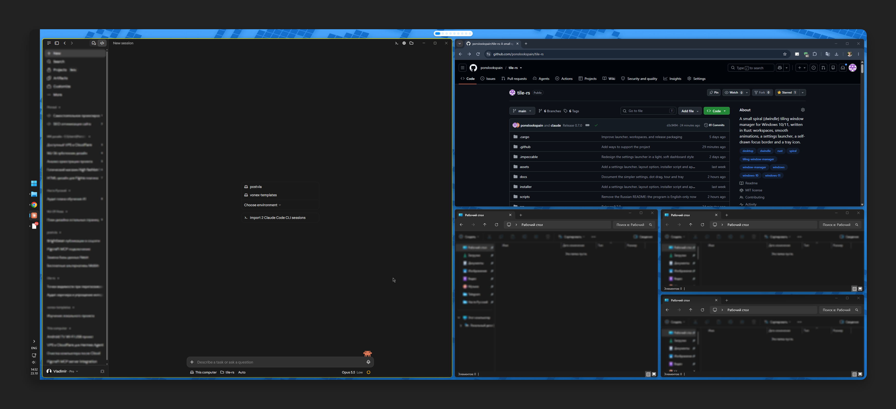
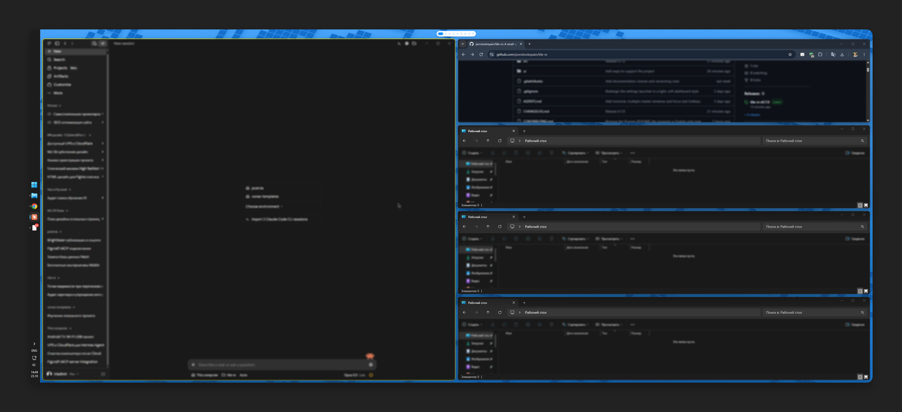
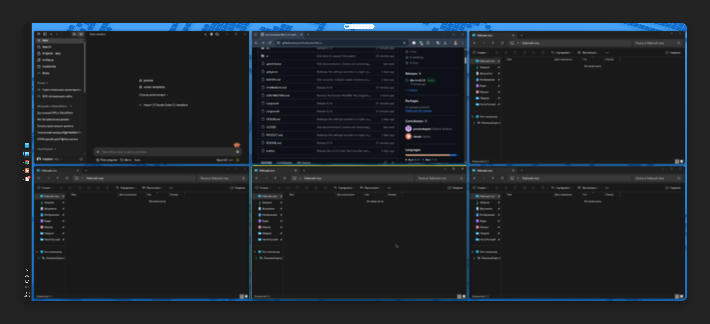
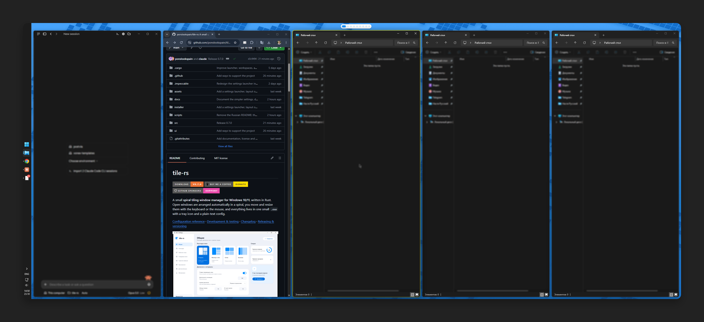

<div align="center">

# tile-rs

**Automatic tiling for Windows 10 and 11. Free, open source, one small `.exe`.**

Open a window and it takes its place on the screen. Close it and the others fill the gap.
Move between windows with the keyboard, or drag them around with the mouse.

[](https://github.com/ponslookspain/tile-rs/releases/latest)
[](https://buymeacoffee.com/ponslook)
[](https://github.com/sponsors/ponslookspain)



[Download](https://github.com/ponslookspain/tile-rs/releases/latest) ·
[Hotkeys](#hotkeys) · [Configuration](docs/CONFIGURATION.md) · [Changelog](CHANGELOG.md)

</div>

## Why tile-rs

- **Works out of the box.** Install, and your windows are arranged. No config file to write first,
  everything can be changed in a settings window.
- **Feels like Windows.** Resize a window by its edge and the neighbours follow. Drag a window onto
  another to swap them. Nothing to relearn if you prefer the mouse.
- **Keyboard when you want it.** `Alt` + arrows to move focus, `Alt+1…9` for workspaces, every
  key can be changed.
- **Light.** A single native Rust program in the tray. No admin rights, no services, no background
  installer.
- **Plays well with games and videos.** Fullscreen windows are never tiled.

## Layouts

| Spiral (default) | Master / stack |
|---|---|
|  |  |
| **Grid** | **Columns** |
|  |  |

Switch with `Ctrl+Alt+L`, from the tray, or on the General page of the settings.

## Install

1. Download **`tile-rs-X.Y.Z-setup.exe`** from the [latest release](https://github.com/ponslookspain/tile-rs/releases/latest).
2. Run it. No administrator rights are needed.
3. The settings window opens with a short tour, and tile-rs starts in the system tray.

> [!NOTE]
> The installer is not code-signed yet, so Windows SmartScreen may warn you the first time.
> Click **More info** → **Run anyway**. You can check the download against the `.sha256` file
> from the same release.

Updates are offered inside the program (Settings → About & updates). Your settings are kept.

<details>
<summary>Portable zip, building from source, uninstalling</summary>

**Portable zip.** Download `tile-rs-vX.Y.Z-windows-x64.zip`, unzip it to a folder you keep (for
example `C:\Tools\tile-rs`) and run `tile-rs.exe`. Do not run it from inside the zip.

**From source.** Needs [Rust](https://rustup.rs) (stable) and the *Desktop development with C++*
workload of the [Visual Studio Build Tools](https://visualstudio.microsoft.com/visual-cpp-build-tools/).

```powershell
git clone https://github.com/ponslookspain/tile-rs.git
cd tile-rs
. .\scripts\vcenv.ps1
cargo build --release
# the program is target\release\tile-rs.exe
```

**Uninstall.** Use *Apps* in Windows Settings for the installed version. For the zip: tray icon →
untick *Start with Windows* → *Quit tile-rs*, then delete the folder. Settings live in
`%APPDATA%\tile-rs` and the log in `%LOCALAPPDATA%\tile-rs`.

</details>

## Features

### Mouse

- Drag an **edge or corner** to resize; the neighbouring windows follow live.
- Drag a window **onto another one** to swap them. Dropped anywhere else, it returns to its place.
- Drag the **gap between windows** to resize both sides at once.
- **Workspace dots** at the top of each screen show where your windows are. Click a dot to switch,
  drag a window onto a dot to move it there and follow it, right-click a dot for more.

### Keyboard

- Move focus, swap windows and change their size without touching the mouse.
- **9 workspaces per monitor.** Windows on other workspaces still show in the taskbar and `Alt+Tab`.
- **Monocle** (`Alt+M`): one window on the whole screen, and back.
- **Jump back** (`Alt+Z`): return to the window you used before.

### Everything else

- **Several monitors**, each with its own layout and workspaces.
- **App rules:** always float a program, or always open it on workspace N.
- **Focus border** around the active window, in any colour.
- **Smooth animations**, and apps redraw their content while they resize.
- **Pause** tiling from the tray or with `Ctrl+Alt+P` when you need your normal desktop back.

## Settings

| General | Hotkeys |
|---|---|
|  |  |

Click the tray icon to open the settings. Changes apply on their own a moment after you make them.

| Page | What is there |
|---|---|
| General | layout with a live preview, gaps, animation; *More options* for tile sizes, workspace dots, fullscreen apps, the focus border and *Reset to defaults* |
| Hotkeys | record any combination by pressing it, add a second one, switch all keys between `Alt` and `Win+Alt` in one click |
| Apps | rules per program: pick an open window or any `.exe` |
| About & updates | start with Windows, check for and install updates, open the config or the log |

Prefer text? Everything is also in `%APPDATA%\tile-rs\config.toml`; see the
[configuration reference](docs/CONFIGURATION.md).

## Hotkeys

| Keys | Action |
|---|---|
| `Alt` + `←↓↑→` (or `H J K L`) | focus the window in that direction |
| `Alt+Shift` + `←↓↑→` | swap with the window in that direction |
| `Alt+1` … `Alt+9` | go to workspace 1…9 |
| `Alt+Shift+1` … `Alt+Shift+9` | send the window to workspace 1…9 |
| `Alt+=` / `Alt+-` | make the window wider / narrower |
| `Alt+M` | monocle on / off |
| `Alt+Shift+F` | float the window / tile it again |
| `Ctrl+Alt+L` | next layout |
| `Ctrl+Alt+P` | pause / resume tiling |

<details>
<summary>All default hotkeys</summary>

| Keys | Action |
|---|---|
| `Alt+H/J/K/L` or `Alt+←↓↑→` | focus the window left / below / above / right |
| `Alt+Shift+H/J/K/L` or `Alt+Shift+←↓↑→` | swap the focused window with that neighbour |
| `Alt+1` … `Alt+9` | switch to workspace 1…9 |
| `Alt+Shift+1` … `Alt+Shift+9` | move the focused window to workspace 1…9 and follow it there |
| `Alt+Shift+.` / `Alt+Shift+,` | next / previous workspace (wraps around) |
| `Ctrl+Alt+.` / `Ctrl+Alt+,` | move the focused window to the next / previous workspace and follow it |
| `Alt+=` / `Alt+-` (also `Alt+Num+` / `Alt+Num-`) | wider / narrower (hold to repeat) |
| `Alt+Shift+M` | minimize the focused window |
| `Alt+Shift+F` | float the focused window in place, or tile it again |
| `Alt+M` | monocle: the focused window on the whole screen, and back |
| `Alt+Z` | focus the previously focused window |
| `Alt+Shift+Z` | go back to the previous workspace |
| `Alt+.` / `Alt+,` | master / stack: one more / one fewer window in the master column |
| `Alt+Shift+Q` | close the focused window (like `Alt+F4`) |
| `Alt+[` / `Alt+]` | focus the previous / next monitor |
| `Alt+Shift+[` / `Alt+Shift+]` | send the focused window to the previous / next monitor |
| `Alt+/` | open the settings on the Hotkeys page: every key in one list |
| `Ctrl+Alt+L` | next layout (spiral, master / stack, grid, columns) |
| `Ctrl+Alt+P` or `Alt+Shift+P` | pause / resume tiling |
| `Ctrl+Alt+Q` | quit (all windows come back to the current workspace) |

Actions without a default key: `grow_height`, `shrink_height`, `retile`, `reload_config` and
`edit_config`.

</details>

## Troubleshooting

| Problem | What to do |
|---|---|
| A hotkey does nothing | Another program already uses it; it is marked on the Hotkeys page. Pick another combination. |
| A window is not tiled | Run `tile-rs.exe list` in a terminal: it lists every window and why it is skipped. |
| An app misbehaves when tiled | Add a *floating* rule for it on the Apps page. |
| An app running as administrator is ignored | Windows does not let normal programs move elevated windows. Run tile-rs as administrator too if you need that. |
| The settings window shows a red "config.toml has an error" banner | The file has a mistake (for example a key tile-rs does not know). The window shows the built-in defaults and saves nothing; *Updates* still works. Fix the line it names, or *Reset settings* (a copy of the file is kept). |
| Windows are missing after a crash | Start tile-rs again, or run `tile-rs.exe --restore-windows`. |
| Something else | Tray → *More* → *Open log*, and [open an issue](https://github.com/ponslookspain/tile-rs/issues). |

<details>
<summary>Command line</summary>

```
tile-rs.exe                    start and open the settings
tile-rs.exe --autostart        start silently (used by "Start with Windows")
tile-rs.exe list               show which windows would be tiled, and why others are not
tile-rs.exe diagnose           export window diagnostics from the running program
tile-rs.exe tile               arrange the current windows once and exit
tile-rs.exe --restore-windows  bring back windows left off-screen after a crash
tile-rs.exe --version
```

</details>

## How it works

tile-rs listens to window events from Windows and places windows with `SetWindowPos`. It does not
replace the desktop or the compositor. Workspaces are emulated: windows of other workspaces are
moved off-screen and come back when you switch. Do not run it together with another tiling manager
(GlazeWM, Komorebi, …). More detail: [window motion](docs/WINDOW-MOTION.md),
[development](docs/DEVELOPMENT.md).

## Support the project

tile-rs is free and open source (MIT), and what it can do today stays free. If it saves you time,
you can support it:

- [**Buy Me a Coffee**](https://buymeacoffee.com/ponslook): a one-time tip, no account needed
- [**GitHub Sponsors**](https://github.com/sponsors/ponslookspain): one-time or monthly

A ⭐ on the repository and telling a friend help too. The same links are in the tray menu
(*Support tile-rs*) and in Settings → About & updates.

## Contributing

Bug reports and ideas are welcome in [issues](https://github.com/ponslookspain/tile-rs/issues).
For code, see [CONTRIBUTING.md](CONTRIBUTING.md); versions and releases are described in
[docs/RELEASING.md](docs/RELEASING.md).

## License

[MIT](LICENSE). The settings window is built with [Slint](https://slint.dev) under the Slint
Royalty-Free Desktop, Mobile and Web Applications License ("Made with Slint" is shown in
Settings → About & updates).
